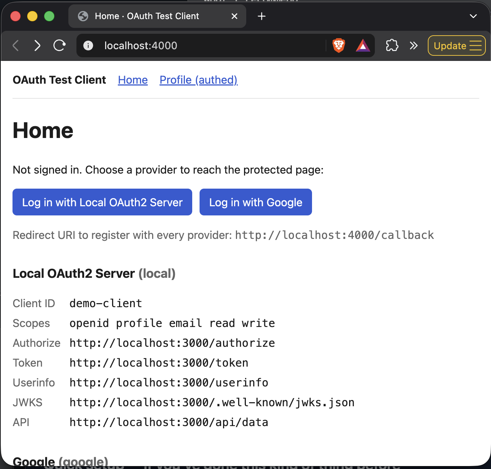

# OAuth2 demo server + test client (TypeScript)



Two small Express apps in one package:

| App | Path | Port | What it is |
|---|---|---|---|
| **Auth server** | `src/server` | 3000 | OAuth 2.0 authorization server (+ OIDC bits) and a protected `/api` |
| **Test client** | `src/client` | 4000 | Web app that logs in against **any** provider and shows an authed `/profile` page |
| **SDK** | `sdk/` | — | TypeScript package for getting tokens and calling `/api`. See [sdk/README.md](sdk/README.md) |

## Quick start

```sh
npm install
npm run dev:server   # terminal 1
npm run dev:client   # terminal 2
open http://localhost:4000   # log in as alice / password (or bob / password)
```

Or with Docker: `docker compose up --build`, then open http://localhost:4000.

## Auth server

Supports the authorization code flow with PKCE (S256 is required), refresh tokens (rotated on every use), and client credentials. Access tokens are RS256 JWTs (`typ: at+jwt`).

State is stored in an embedded [RocksDB](https://rocksdb.org) datastore under `DATA_DIR` (default `./data`): authorization codes, refresh tokens, revoked access tokens, API notes, and the generated signing key. It's a plain directory with no database server to run. Restarting the server keeps everyone's tokens valid; delete the directory to reset.

| Endpoint | Purpose |
|---|---|
| `GET /.well-known/openid-configuration` | Discovery metadata (also at `/.well-known/oauth-authorization-server`) |
| `GET /.well-known/jwks.json` | Public signing key |
| `GET/POST /authorize` | Login + consent page, issues the authorization code |
| `POST /token` | `authorization_code`, `refresh_token`, `client_credentials` |
| `GET /userinfo` | OIDC claims (needs the `openid` scope) |
| `POST /introspect` | RFC 7662 (confidential clients only) |
| `POST /revoke` | RFC 7009 (refresh tokens or access tokens) |
| `GET /api/me` | Any valid token |
| `GET /api/data`, `GET /api/notes` | Needs the `read` scope |
| `POST /api/notes` | Needs the `write` scope |

Client authentication: `client_secret_basic`, `client_secret_post`, or `none` (public clients with PKCE).

```sh
# Machine-to-machine example
TOKEN=$(curl -s -u demo-client:demo-secret localhost:3000/token \
  -d grant_type=client_credentials -d scope=read | jq -r .access_token)
curl -H "Authorization: Bearer $TOKEN" localhost:3000/api/data
```

### Server env vars

| Var | Default | Notes |
|---|---|---|
| `PORT` | `3000` | |
| `ISSUER` | `http://localhost:3000` | Public URL. Used as `iss`/`aud` and in discovery |
| `DATA_DIR` | `./data` | RocksDB datastore directory (one server process at a time) |
| `SIGNING_KEY_PEM` | *(generated)* | PKCS#8 RSA key. If unset, a key is generated on first start and stored in the datastore |
| `ACCESS_TOKEN_TTL` / `REFRESH_TOKEN_TTL` | `900` / `86400` | Seconds |
| `DEMO_CLIENT_ID` / `DEMO_CLIENT_SECRET` | `demo-client` / `demo-secret` | |
| `DEMO_CLIENT_REDIRECT_URIS` | `http://localhost:4000/callback` | Comma-separated, matched exactly |
| `CLIENTS_JSON` | — | Replaces the client list: `[{"clientId","clientSecret?","redirectUris":[],"allowedScopes":[],"name"}]`. Leave out `clientSecret` for a public client |
| `USERS_JSON` | alice, bob | `[{"id","username","password","name","email"}]` |

## Test client

The client supports several providers side by side. The home page has one login button for each provider that's configured:

- **Local**: the bundled `dev:server`, a standalone provider that is always enabled.
- **Google**: enabled when `GOOGLE_CLIENT_ID` and `GOOGLE_CLIENT_SECRET` are set.

The flow: `/login?provider=…` → provider authorize page → `/callback` → `/profile`. The callback checks `state`, checks `iss` against the provider when it's sent (RFC 9207), and exchanges the code with the PKCE verifier. It then verifies the ID token's **signature against the provider's JWKS**, plus `iss`, `aud`, `exp` and `nonce`. Tokens stay on the server; the browser only gets an HttpOnly session cookie. `/profile` shows the user info, the verified ID token claims, the access token (decoded if it's a JWT; Google's are opaque), and the result of calling that provider's API. It also has Refresh and Logout buttons (logout revokes the tokens with the provider).

### Log in with Google

1. Go to [Google Cloud Console → APIs & Services → Credentials](https://console.cloud.google.com/apis/credentials) and choose **Create credentials → OAuth client ID → Web application**. Set up the OAuth consent screen first if prompted (an "External" app in testing mode is fine; add yourself as a test user).
2. Under **Authorized redirect URIs**, add `http://localhost:4000/callback`.
3. `cp .env.example .env` and fill in `GOOGLE_CLIENT_ID` / `GOOGLE_CLIENT_SECRET`. The client loads `.env` automatically. With Docker, `docker compose` reads the same `.env`.
4. Restart `npm run dev:client` (watch mode doesn't pick up `.env` changes), open http://localhost:4000 and click **Log in with Google**.

The client sends `access_type=offline&prompt=consent` so that Google returns a refresh token every time, which lets you test refresh. Google access tokens only work against Google APIs, not this server's `/api`. To have `/profile` call one, set `GOOGLE_API_URL` and add the matching scope to `GOOGLE_SCOPES`.

### Client env vars

| Var | Default |
|---|---|
| `PORT` / `BASE_URL` | `4000` / `http://localhost:4000` (redirect URI is `$BASE_URL/callback`) |
| `AUTH_SERVER_PUBLIC_URL` | `http://localhost:3000`: the URL of the local server that the browser is redirected to. Also its expected `iss` |
| `AUTH_SERVER_INTERNAL_URL` | same as public: used for server-to-server calls (differs in Docker/k8s) |
| `LOCAL_CLIENT_ID` / `LOCAL_CLIENT_SECRET` / `LOCAL_SCOPES` | `demo-client` / `demo-secret` / `openid profile email read write` |
| `GOOGLE_CLIENT_ID` / `GOOGLE_CLIENT_SECRET` | unset (Google disabled) |
| `GOOGLE_SCOPES` | `openid email profile` |
| `GOOGLE_API_URL` | unset: a Google API to call on `/profile` |
| `GOOGLE_PROMPT` | `consent` |

## Kubernetes

```sh
docker build -t oauth2-demo:latest .     # load into your cluster (kind load / minikube image load) or push to a registry
kubectl apply -f k8s/oauth.yaml
kubectl -n oauth-demo port-forward svc/oauth-server 3000:3000 &
kubectl -n oauth-demo port-forward svc/oauth-test-client 4000:4000 &
open http://localhost:4000
```

To enable Google in the cluster, add `google-client-id` / `google-client-secret` to the `oauth-demo` Secret.

The manifest sets `ISSUER`/`BASE_URL` to the port-forwarded localhost URLs. If you put the apps behind an Ingress, change those URLs and the redirect URI to match.

## Limitations (it's a demo)

- The server persists its state (authorization codes, refresh tokens, revocations, notes, generated signing key) in an embedded **RocksDB** directory (`DATA_DIR`). That makes it single-process: RocksDB locks the directory, so run **one** server replica (k8s uses `Recreate` + a PVC). The test client's sessions are still in memory.
- Users and clients come from env vars, and passwords are plaintext. Use a real user store with password hashing (argon2/bcrypt) before relying on this.
- No rate limiting on `/authorize` or `/token`. Deploy with HTTPS (also set `BASE_URL` to `https://…` so the client marks cookies `Secure`).
